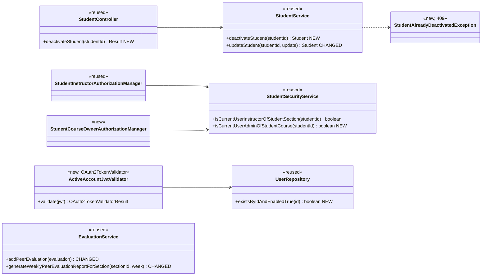
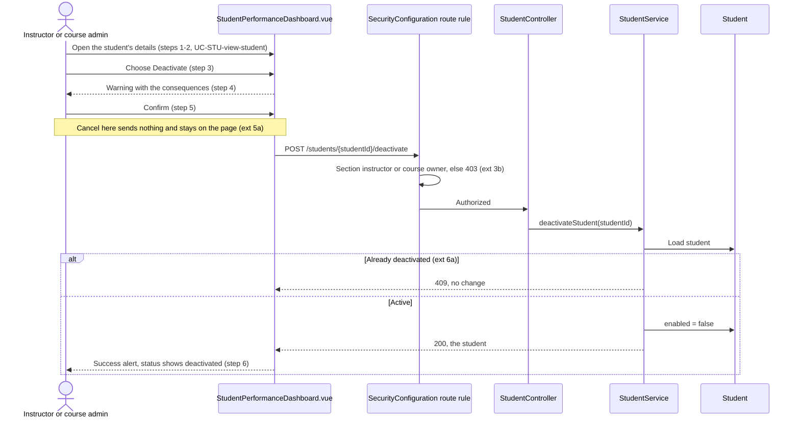
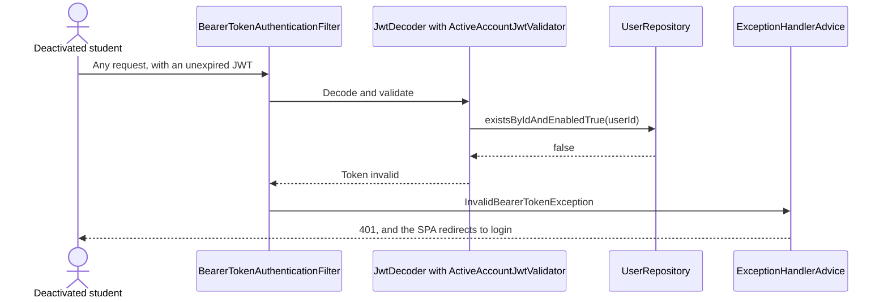

# Students (STU) Design

> Realizes: UC-STU-deactivate-student
> Depends on: FR-SEC-active-account, BR-student-lifecycle, BR-section-scoped-access, BR-deactivated-student-team, BR-evaluation-active-evaluatee, BR-evaluation-report-deactivated, BR-submission-owed, BR-evaluation-editable-until-close, BR-lock-expiry
> See: [use cases](../requirements/use-cases.md#uc-stu-deactivate-student-the-course-admininstructor-deactivates-a-student), [business rules](../requirements/business-rules.md), [architectural-design.md](architectural-design.md#authentication-and-an-authorized-request)
> Designed against `main` at `59f0267` (2026-11-06).

## Overview

Before this design, deactivation was a switch on the student edit form that flipped `enabled`, with no warning, and only login read the flag. This area adds a dedicated, guarded action with a warning, makes every bearer request honor the flag, and aligns the two peer evaluation paths that ignored it. `SubmissionStatusService.findOwedItems` already applied BR-submission-owed correctly and does not change. There is no data-model change: `enabled` already exists on `PeerEvaluationUser`.

## Components & classes

**Backend** (under `backend/src/main/java/team/projectpulse/`)

- [`security/SecurityConfiguration.java`](../../backend/src/main/java/team/projectpulse/security/SecurityConfiguration.java): the new route rule, and `jwtDecoder()` gains the validator alongside the default ones (expiry must still be checked).
- `security/ActiveAccountJwtValidator.java`: new. Reads the `userId` claim and fails the token when no active account has that id.
- `security/authorizationmanagers/StudentCourseOwnerAuthorizationManager.java`: new.
- [`student/StudentSecurityService.java`](../../backend/src/main/java/team/projectpulse/student/StudentSecurityService.java), [`student/StudentController.java`](../../backend/src/main/java/team/projectpulse/student/StudentController.java), [`student/StudentService.java`](../../backend/src/main/java/team/projectpulse/student/StudentService.java): changed as in the diagram.
- `system/exception/StudentAlreadyDeactivatedException.java`: new, with a 409 handler in [`system/exception/ExceptionHandlerAdvice.java`](../../backend/src/main/java/team/projectpulse/system/exception/ExceptionHandlerAdvice.java).
- [`user/UserRepository.java`](../../backend/src/main/java/team/projectpulse/user/UserRepository.java), [`evaluation/EvaluationService.java`](../../backend/src/main/java/team/projectpulse/evaluation/EvaluationService.java): changed as in the diagram.
- **Deliberately unchanged:** [`notification/SubmissionStatusService.java`](../../backend/src/main/java/team/projectpulse/notification/SubmissionStatusService.java), `EvaluationService.updatePeerEvaluation`, `StudentService.findStudentsByTeamId`.

**Frontend** (under `frontend/src/`)

- [`pages/students/StudentPerformanceDashboard.vue`](../../frontend/src/pages/students/StudentPerformanceDashboard.vue): this page is the details view of UC-STU-view-student. It gains a status tag and, for an active student only, the Deactivate button and its `ElMessageBox` warning. On a 409 it reloads the student, so the page shows the true status. The request interceptor already shows the server's message.
- [`apis/student/index.ts`](../../frontend/src/apis/student/index.ts): new `deactivateStudent`.
- [`pages/students/EditStudentForm.vue`](../../frontend/src/pages/students/EditStudentForm.vue): the Status switch renders only when the loaded student is deactivated.
- [`pages/evaluations/SubmitTeamsEvaluations.vue`](../../frontend/src/pages/evaluations/SubmitTeamsEvaluations.vue): a new submission builds rows only for teammates with `enabled` true. When a submission fails, the page reloads the student's saved evaluations and continues in update mode (UC-EVA-submit-evaluation extension 9a).

## Sequence

### UC-STU-deactivate-student: the main success scenario

### UC-STU-deactivate-student: a token issued before deactivation (POST-2)

## API contract

| Endpoint or job | Caller (who may) | Request | Success | Errors, by extension |
|---|---|---|---|---|
| `POST /students/{studentId}/deactivate` (new) | An instructor assigned to the student's course section, or the course admin who owns its course | No body | 200, the student with `enabled: false` | 3b: 403, also for an id naming no student, because guards fail closed. 6a: 409 |
| `PUT /students/{studentId}` (changed) | Unchanged | `enabled: false` from an instructor, on an active student | Other edits unchanged. `enabled: true` on a deactivated student still reactivates her (interim) | 400, message points to the deactivate action. A student's own `enabled` value is still ignored, not refused |
| `POST /evaluations` (changed) | Unchanged | Evaluatee's account is not active | Unchanged | UC-EVA-submit-evaluation 9a: 400, naming the condition |
| `GET /evaluations/sections/{sectionId}/week/{week}` (changed) | Unchanged | Unchanged | A deactivated student is listed only for weeks with evaluations of her (BR-evaluation-report-deactivated) | None new |
| Any bearer-authenticated route (changed) | The token's account must be active | Unchanged | Unchanged | 401 when the account is deactivated or no longer exists |

## Key decisions

- **The active-account check is a JWT validator on the decoder.** Validation failure already flows to `InvalidBearerTokenException` and the existing 401 handler, and the SPA already redirects on 401. *Rejected:* a servlet filter, which would write its own error response outside that path. *Rejected:* a token denylist, which adds server state and breaks the statelessness the [scaling model](architectural-design.md#scaling-model--path-to-multi-instance) relies on. *Rejected:* amending FR-SEC-active-account to allow a two-hour window, because she could keep reading and submitting student records.
- **It covers every account, not only students.** FR-SEC-active-account names students and instructors, and the validator has no reason to tell them apart. This also makes UC-INS-deactivate-instructor's access revocation real, though that use case's flow is not designed here.
- **Who may deactivate is two guards composed with `AuthorizationManagers.anyOf`,** the pattern the reminder routes use. `isCurrentUserInstructorOfStudentSection` alone would shut out a course admin not assigned to the course section, contradicting BR-student-lifecycle. *Rejected:* `UserOwnershipAuthorizationManager`, which admits the student herself and also guards PUT and DELETE, so widening it would change unrelated routes.
- **A dedicated POST is the only way to deactivate.** *Rejected:* a status flag on PUT, because that is the unguarded path this use case replaces. The same PUT keeps its reactivating direction only because UC-STU-reactivate-student is not built yet; that use case's Associated Information records the constraint and the stale-form gap.
- **A stale request gets 409 rather than an idempotent 200.** A 200 would produce the step 6 alert for something this instructor did not do. *Rejected:* idempotent success.
- **The deactivated student stays on her team (BR-deactivated-student-team).** *Rejected:* removal, because `generateWeeklyPeerEvaluationReportForSection` filters on `team != null` and would drop her past weeks too, and because an instructor would be doing what BR-team-admin-only reserves for a course admin.
- **The report rule keys on whether evaluations exist for the week.** `getPeerEvaluationAverage` returns 0.0 with no evaluations, which reads as a score of zero. *Rejected:* a stored deactivation date, which needs a migration and a reactivation rule and shows the instructor nothing more.
- **The server enforces the evaluatee rule and the form only mirrors it.** `POST /evaluations` is reachable without the form. *Rejected:* filtering `findStudentsByTeamId`, which would make a roster lookup misreport team membership.
- **Build order.** The validator and repository method are the trunk, since every authenticated request passes through them, so they are the first commit, on their own. The route rule and its guard come next, then the leaves.

## Reuse & cross-cutting

- **Authorization:** `AuthorizationManager` guards that fail closed and never throw ([Security & Compliance](architectural-design.md#security--compliance)).
- **Errors:** the `Result` envelope, `ExceptionHandlerAdvice`, and `StatusCode.CONFLICT`. The `PUT` refusal reuses the existing `IllegalArgumentException` handler, and the evaluatee refusal reuses `PeerEvaluationIllegalArgumentException`.
- **Who owes what:** [design/not.md](not.md), unchanged. A deactivated student stops owing and stops being owed without any change there.
- **Edit locks:** BR-lock-expiry releases any lock she holds. Nothing is released early.

## Tests

| Use case, flow | Level | Asserts |
|---|---|---|
| Main: assigned instructor deactivates | Integration | 200; `enabled` false; team unchanged; her weekly activity reports and peer evaluations still present |
| Main: step 4 warning | Cypress, API stubbed | The dialog states the consequences, and no request is sent before confirming |
| Main: step 6 alert | Cypress, API stubbed | Success message shown; status shows deactivated |
| Ext 3a: already deactivated | Cypress, API stubbed | Status shows deactivated; no Deactivate button |
| Ext 3b: instructor of another course section | Integration | 403; student still active |
| Ext 3b: the student herself, and a teammate | Integration | 403; student still active |
| Ext 3b: owning course admin not assigned to the course section | Integration | 200 (the permitted side of the boundary) |
| Ext 3b: id naming no student | Integration | 403 |
| Ext 5a: cancel at the warning | Cypress, API stubbed | Zero POST requests; still on the student's details |
| Ext 6a: stale request | Unit and integration | 409; state unchanged |
| Ext 6a: the page after a 409 | Cypress, API stubbed | Student reloaded; status shows deactivated; no Deactivate button |
| POST-2: token issued before deactivation | Integration | The next request with that token gets 401 |
| POST-2: login after deactivation | Integration | 401 |
| FR-SEC-active-account: deactivated instructor's token | Integration | 401 |
| FR-SEC-active-account: an active user's token | Integration | Still accepted (guards against a validator that refuses everyone) |
| BR-submission-owed: after deactivation | Integration | She is absent from owing; a teammate who evaluated everyone else owes nothing; no reminder goes to her |
| BR-evaluation-active-evaluatee: new evaluation of her | Unit and integration | 400; no row saved |
| BR-evaluation-active-evaluatee: edit of an existing evaluation of her | Unit | Succeeds inside the submission window |
| UC-EVA-submit-evaluation: the form | Cypress, API stubbed | A new submission has no row for a deactivated teammate |
| UC-EVA-submit-evaluation ext 9a: deactivated while the form is open | Cypress, API stubbed | One POST refused; the page reloads saved evaluations and continues in update mode |
| BR-evaluation-report-deactivated | Unit | Deactivated with evaluations: listed. Deactivated without: absent. Active without evaluations: listed |
| Edit path: instructor sends `enabled: false` on an active student | Integration | 400; still active |
| Edit path: instructor sends `enabled: true` on a deactivated student | Integration | Reactivated (interim) |
| Edit path: student sends `enabled: false` on herself | Integration | Ignored; still active (existing test must keep passing) |
| Edit path: switch visibility | Cypress, API stubbed | Hidden for an active student; shown for a deactivated one |

Cypress is not part of CI or `mvn package`. The row in `traceability.md` may claim a Cypress-only flow as tested only if that spec was actually run against the build; otherwise Verify is `🟡 Partial` and the flow is named as untested.

## Open questions / risks

- **Course admin not assigned to the course section.** The new route admits her, but `GET /students/{studentId}` and the student list do not, so she can reach the action through the API and not through step 2 of the UI. It is rare, since creating a course section assigns its creator. Widening that shared guard is a separate decision, to be filed as a follow-up issue.
- **Stale edit form.** A form opened while she was active and saved after she was deactivated sends `enabled: true` and reactivates her. It ends when UC-STU-reactivate-student is built.
- **An old token revives on reactivation.** The validator checks the account's present state, so an unexpired token works again once she is reactivated. Recorded in UC-STU-reactivate-student.
- **One extra primary-key query per bearer request.** The SRS ranks security above performance. Not measured.
- **Forgot-password is not blocked.** A deactivated student can still request a reset email and set a new password. Login stays refused, so access is not affected.
- **Login message.** A deactivated student's login gets the existing "User account is abnormal." Not improved here.
